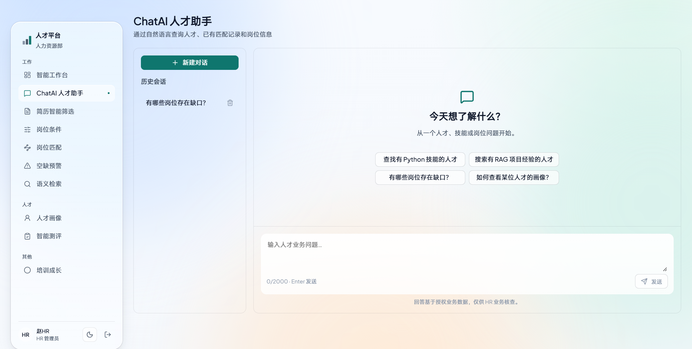
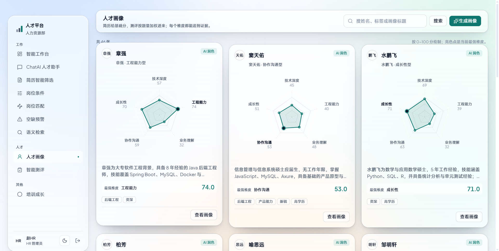

# AI 数字化人才平台

> 简历入库与智能筛选、岗位画像与匹配、人才画像、智能测评与培训管理，内置可对话的 ChatAI 人才助手。

把招聘链路串成一个工作台：简历、岗位、匹配、画像、测评、培训在同一处完成，页面能操作的业务，也能直接用自然语言问 ChatAI 人才助手。当前维护的是根目录下的 `frontend/`（由原 v2 迁入）和 `backend/`，旧前端不再维护。

产品范围、业务规则、验收标准和后续优先级见 [产品需求文档（PRD）](docs/产品需求文档.md)。

## 界面预览

| ChatAI 人才助手 | 人才画像 |
| :---: | :---: |
|  |  |
| 自然语言查询人才、已有匹配记录和岗位信息，回答基于授权业务数据，仅供 HR 业务核查。 | 简历给基础分、测评按题量加权进分，五个维度均可追溯到证据。 |

## 功能概览

| 模块 | 页面 | 主要能力 |
| --- | --- | --- |
| 智能工作台 | `/dashboard` | 招聘进度、简历与匹配的整体概览 |
| ChatAI 人才助手 | `/chat` | 多轮对话、流式回答、历史会话，答案限定在授权业务数据内 |
| 简历智能筛选 | `/resumes` | 简历上传与解析、结构化字段、条件检索与疑点复核 |
| 岗位条件 | `/job-profiles` | 岗位画像与任职要求的维护 |
| 岗位匹配 | `/matching` | 岗位与候选池的匹配计算、匹配列表与匹配详情 |
| 空缺预警 | `/vacancy` | 按岗位缺口查看预警 |
| 语义检索 | `/semantic` | 向量语义召回，补足关键词检索的召回缺口 |
| 人才画像 | `/talent-profiles` | 五维雷达图与维度评分，每个维度可追溯到证据 |
| 智能测评 | `/exams` | 题库导入、试卷派发、在线作答与成绩结果 |
| 培训成长 | `/training` | 培训课程与个人培训记录 |
| 系统管理 | `/system` | 用户、角色与基础配置 |

## 技术栈

- **前端**：React 19 + TypeScript + Vite 7，路由用 React Router 6，数据请求用 TanStack Query 5，图标用 lucide-react，样式为 CSS Modules。
- **后端**：FastAPI + Starlette、SQLAlchemy 2、PyMySQL，鉴权用 PyJWT，配置从 `backend/.env` 加载。
- **数据与 AI**：MySQL 为业务库；Redis 可选；Milvus 承担向量检索，语义能力还依赖 Ollama 嵌入服务；AI 网关负责 ChatAI 的模型调用与流式输出。
- **文档处理**：PyMuPDF、pypdf、python-docx、openpyxl 用于简历解析与导入导出，reportlab 用于生成文档。

## 目录与分层

```text
frontend/                 React View：页面、组件、路由及 API 客户端
backend/
  app/main.py             FastAPI 应用装配与路由注册
  app/controllers/       Controller：HTTP 参数、权限入口、统一响应
  app/services/          业务规则、对象归属、查询与事务编排
  app/models/            Model：SQLAlchemy 表映射
  app/infrastructure/    本地存储、AI 网关、嵌入模型、向量库适配
  app/core/              配置、数据库连接、鉴权及通用响应
  scripts/               数据库初始化、迁移、样本生成等运维脚本
  storage/               运行时简历等文件，不提交源码仓库
scripts/windows/         根目录启停入口调用的内部脚本
tests/                   后端回归、浏览器探针、评测数据、演示样本
  seed_data.sql          首次初始化用的种子数据
docs/                    设计、演示、历史验收与前端交付资料
docs/images/             README 使用的界面截图
backup/                  现有数据库备份
logs/                    运行日志
```

请求路径：`frontend/src` → `/api` → `controllers` → `services` → `models` / `infrastructure`。改动 API 时同时检查权限、响应格式和前端调用。模型层不依赖业务服务或控制器；不为每张表强制增加空 DAO。

## 本地启动（Windows）

已有依赖和数据库时，从项目根目录运行 `一键启动.bat`，停止使用 `一键停止.bat`。启动脚本会复用本工作区已在运行的进程并做端口健康检查，停止脚本只回收本工作区启动的进程树。

前端端口 **5174**，后端端口 **8000**；健康检查为 `/api/health`，接口文档为 `/docs`。默认本地依赖包括 MySQL；Redis 为可选，AI、OCR 和向量能力取决于本地配置及服务可用性。

新环境使用 Python 3.12 和支持当前 Vite 的 Node.js。以下命令从根目录运行：

```powershell
python -m venv backend/.venv
backend/.venv/Scripts/python.exe -m pip install -r backend/requirements.txt
npm --prefix frontend ci
```

新环境可从 `backend/.env.example` 创建 `backend/.env` 并填入实际连接配置，**不要覆盖已有 `.env`**。只在有明确授权的开发数据库上运行初始化：

```powershell
backend/.venv/Scripts/python.exe backend/scripts/init_db.py
```

`init_db.py --reset` 会删除并重建目标库，不属于例行启动。后端配置从 `backend/.env` 加载，默认上传目录为 `backend/storage/`。启动包装脚本会执行 ChatAI 幂等增量迁移，已有业务数据保持原状。Milvus 使用现有 Docker 容器，语义检索还依赖 Ollama 嵌入服务。

## Docker 部署（拉取镜像运行）

平台已发布到 GitHub Container Registry，机器上有 Docker 即可运行，不需要本地装 Python 和 Node：

```bash
docker pull ghcr.io/moliclay/ai-talent-api:latest
docker pull ghcr.io/moliclay/ai-talent-web:latest

docker compose up -d
```

打开 <http://localhost:8080>，演示账号 `admin` / `123456`（另有 `hr_zhao`、`pm_wang`、`emp_chen`，密码相同）。首次启动 api 容器会自动等待 MySQL、建库建表、灌入种子数据；`compose` 里已包含 MySQL 8.0 与 Redis 7。

镜像只有 `linux/amd64`。环境变量、纯 `docker run` 方式、数据卷与已知限制见 [Docker 部署说明](docs/docker-deploy.md)。

## 验证与资料

```powershell
npm --prefix frontend run build
backend/.venv/Scripts/python.exe -B tests/backend/eval_parse.py
backend/.venv/Scripts/python.exe -B tests/backend/eval_match_30.py
```

上述两个评测不需要修改业务数据库。带登录、索引重建和提交的集成脚本只应指向隔离的测试环境，详见 [测试说明](tests/README.md)。[概要设计](docs/design/概要设计.md) 和 [历史交付](docs/MVP-1-历史说明.md) 保留当时的设想、旧版路径和验收记录；当前启动、目录与验证命令以本文件为准。

## 相关文档

- [产品需求文档（PRD）](docs/产品需求文档.md)：业务规则、验收标准与优先级
- [全平台落地验收报告](全平台落地验收报告.md)：验收结果与上线条件
- [ChatAI 开发方案](ChatAI-开发方案.md) 与 [ChatAI TODO](ChatAI-TODO.md)：ChatAI 设计与待办
- [概要设计](docs/design/概要设计.md)、[测试说明](tests/README.md)：分层设计与测试约定
